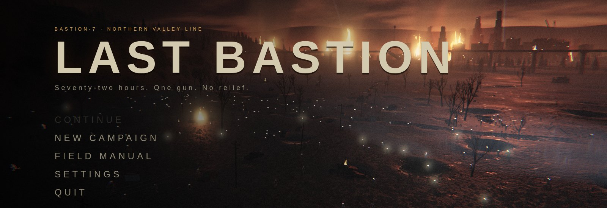
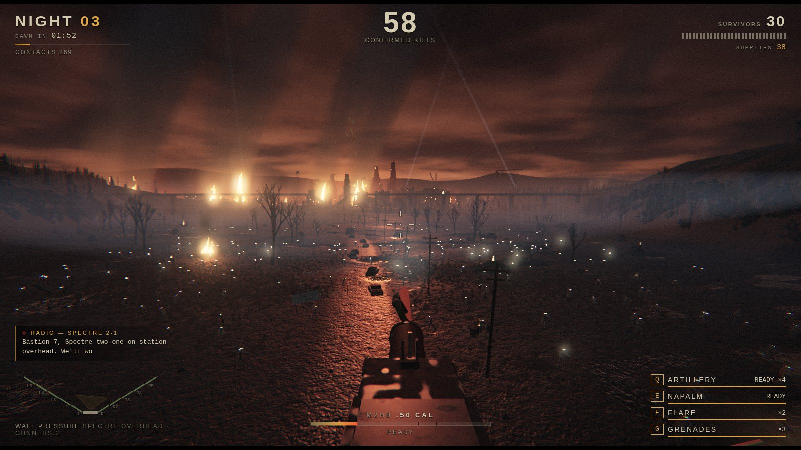
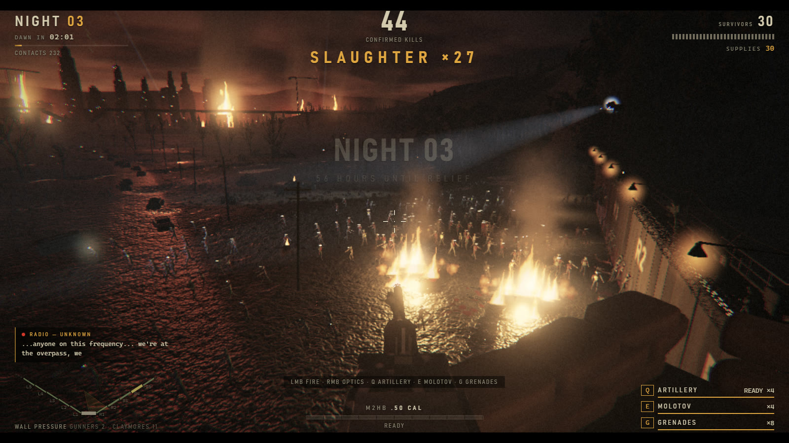
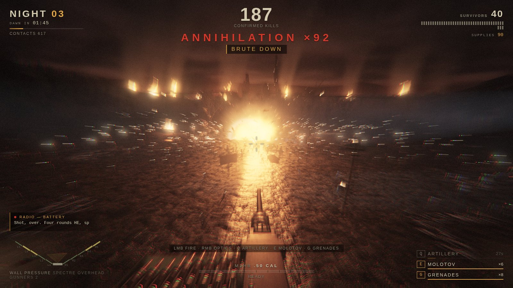
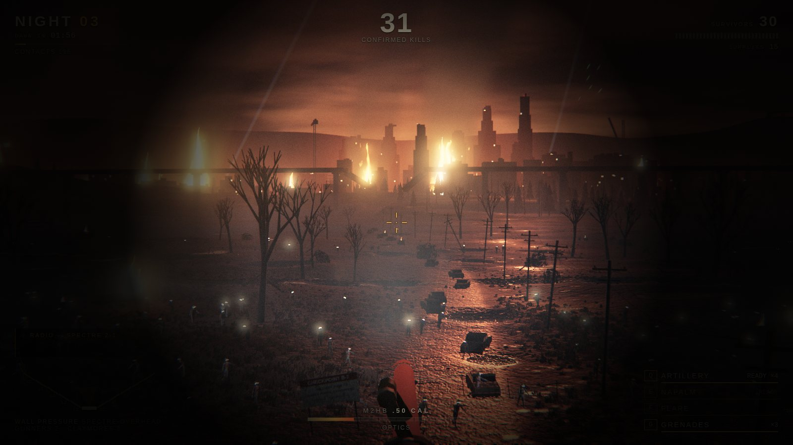
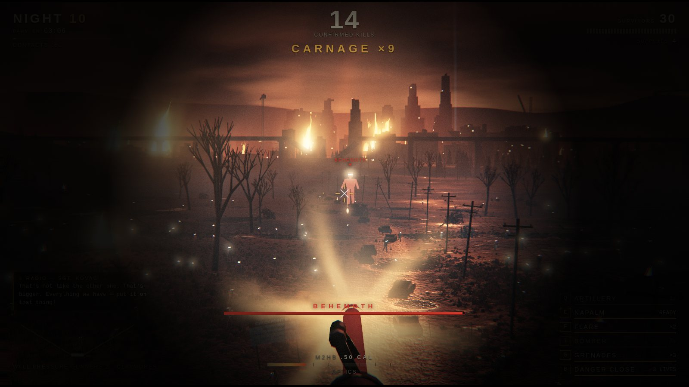
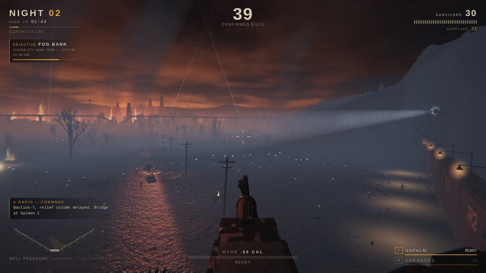
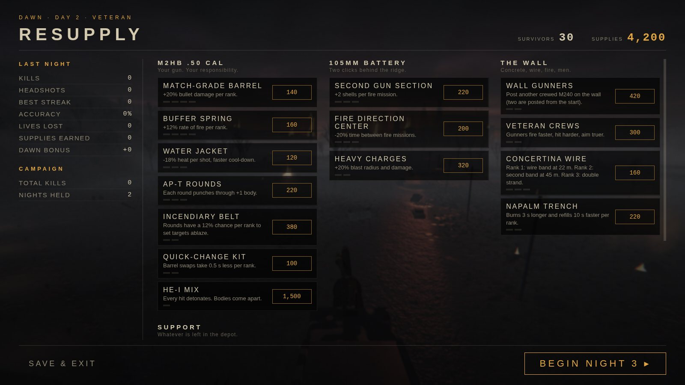
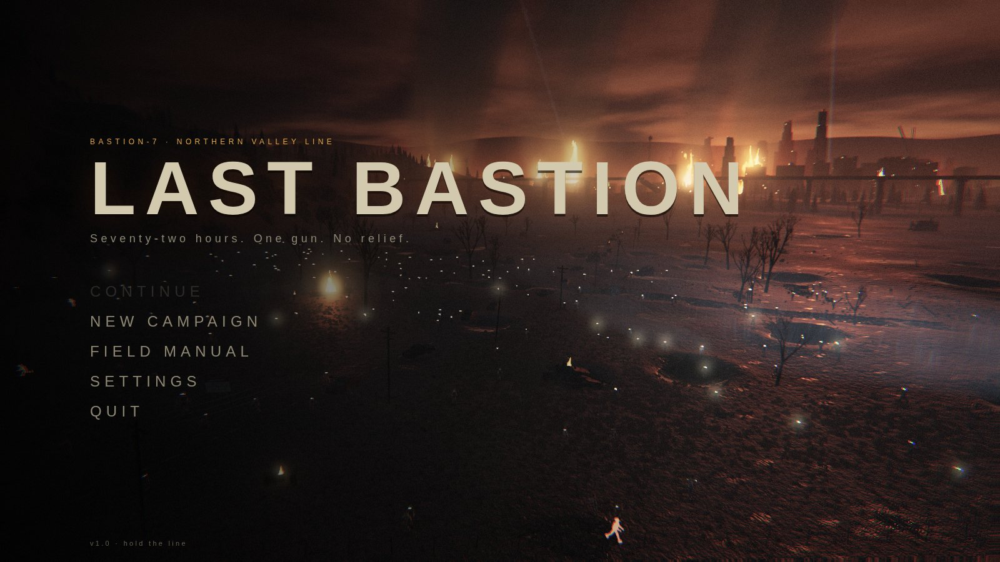

<div align="center">



# L A S T &nbsp; B A S T I O N

### *Seventy-two hours. One gun. One way out.*


**[Play it](#-run-it) · [How to play](#-how-to-play) · [The ten nights](#-the-ten-nights) · [Under the hood](#-under-the-hood) · [Build an .exe](#-build-a-windows-exe)**

</div>

---

You man an **M2HB .50 cal** on the apex of a V-shaped wall at the mouth of a valley.
Every night the dead come down that valley **in their thousands**.

Hold until dawn. Spend what you scavenged. Do it again.

<p align="center">
  
  <br><sub><b>Night 3.</b> 269 contacts in the valley, Spectre on station overhead, the city burning on the horizon.</sub>
</p>

> [!NOTE]
> **The world is painted procedurally at startup.** No texture packs: the mud, the
> T-wall concrete, the zombies' torn clothes and the burning skyline are all generated in code.
> The exceptions are the downloaded models: your M2HB, the aircraft and helicopters, the soldiers,
> the trucks, car wrecks and containers, and the scanned kit that dresses the bastion (ammo cans, crates, drums, barriers, generators: CC0, Poly Haven).
> The sound is the opposite: real field recordings, a real .50 BMG report and an adaptive score.

---

## 🔥 What it looks like

<table>
  <tr>
    <td width="50%"></td>
    <td width="50%"></td>
  </tr>
  <tr>
    <td align="center"><b>[E] Molotov.</b> Light the rag, throw the bottle. The dead walk into the fire screaming.</td>
    <td align="center"><b>[Q] 105 mm fire mission.</b> Four rounds HE, splash in three. <i>Carnage ×16.</i></td>
  </tr>
  <tr>
    <td width="50%"></td>
    <td width="50%"></td>
  </tr>
  <tr>
    <td align="center"><b>[RMB] Optics.</b> Zoom, tighter spread, and the whole dead city in the glass.</td>
    <td align="center"><b>Night 10: the Behemoth.</b> <i>"That's not like the other one. That's bigger."</i></td>
  </tr>
  <tr>
    <td width="50%"></td>
    <td width="50%"></td>
  </tr>
  <tr>
    <td align="center"><b>Night 2: Fog bank.</b> Visibility near zero, Spectre is blind, sodium lamps on the wall.</td>
    <td align="center"><b>Dawn.</b> Spend the night's supplies on the gun, the battery and the wall.</td>
  </tr>
</table>

---

## ▶ Run it

> **Requirements:** Node.js 22+ ([nodejs.org](https://nodejs.org)). That's it.

**From VS Code** (the easy way):

1. Open this folder in VS Code.
2. Press **F5** and pick **Play Last Bastion**.

The first launch installs dependencies and downloads Electron (~1 minute). After that, F5 rebuilds and
launches in a couple of seconds.

**Or any of these:**

| How | What |
|---|---|
| `Ctrl+Shift+B` | VS Code build task **Play Last Bastion** |
| `run.cmd` / `run.sh` | Double-click launcher (Windows / macOS / Linux) |
| `npm start` | Bundle + launch from a terminal |
| `npm run watch` | Rebuild on save while you tweak (`Ctrl+R` in the game window reloads) |

*Play Last Bastion (windowed)* starts in a window instead of fullscreen. `F11` toggles fullscreen,
`F12` opens DevTools. The graphics preset is chosen automatically on first launch with a short benchmark
of a heavy night; *Settings ▸ Quality ▸ AUTO* runs it again.

---

## 🎯 How to play

| Input | Action |
|:---:|---|
| 🖱️ **Mouse** | Traverse the gun |
| **LMB** | Fire |
| **RMB** | Optics: zoom and a tighter spread |
| **Q** | 105 mm fire mission on the crosshair |
| **E** | Light and throw a Molotov at the crosshair, one bottle at a time |
| **T** | Red marker flare anywhere on the field. A bomber puts a **2000 lb bomb** on it (75 s re-arm) |
| **G** | Throw a grenade at the crosshair (one per press) |
| **B** | ☠️ **Danger close.** Carpet the wall line. Costs 3 survivors. Once per night. |
| **Esc** | Pause |

### 🧱 The pile

Zombies that reach the wall press against it and **climb on each other**. Each wall section
(L1–L5, R1–R5, painted on the wall and shown on the *Wall Pressure* map) builds its own pile.
When a pile reaches the top, they climb over, and **every one that makes it kills a survivor**.
Lose them all and Bastion-7 falls.

Look left and right along the wall faces. Cut the piles down.

### 🧟 The horde

| | Type | From | Notes |
|:---:|---|:---:|---|
| 🚶 | **Shambler** | night 1 | Slow. There are a lot of them. |
| 🏃 | **Runner** | night 2 | Fast. Reach the wall before you notice. |
| 🦍 | **Brute** | night 3 | Counts as **three bodies** on a pile. |
| 🎈 | **Bloater** | night 4 | Bursts and chain-reacts. If one reaches the wall, its **acid melts a ramp** the others can climb. |

Surges are announced with a siren and the side they're coming from. The last stretch of every
night is **the tide**.

### ✈️ Support

**Spectre**, an AC-130 gunship, circles the valley all night and works the crowds in the field
with its GAU-12 Gatling, in long tearing bursts. It won't fire close to the wall. That part is still yours.

Your arsenal grows over the radio:

```
NIGHT 1 ─── the fifty + two crewed M240s on the wall
NIGHT 2 ─── Molotovs · grenades · claymores
NIGHT 3 ─── 105 mm battery · Spectre
NIGHT 4 ─── the bomber
NIGHT 5 ─── danger close
```

The dawn resupply only offers what's in play by the coming night (schedule: `UNLOCKS` in `src/config.js`).

---

## 🌙 The ten nights

Every night has its own event and its own radio traffic. Objectives, a boss bar and markers show up on the HUD.

| Night | Event |
|:---:|---|
| **1** | A recon patrol fighting its way back to the gate |
| **2** | A **fog bank** that blinds you *and* the gunship |
| **3** | The civilians from the overpass make a run for it |
| **4** | A resupply drop you have to hold until it's recovered |
| **5** | 🗿 **Goliath**: a giant that smashes ramps into the wall and kills a man every other blow |
| **6** | A brute stampede down one flank |
| **7** | **Blackout**: the generator dies, the lamps go out |
| **8** | Spectre goes down in the hills |
| **9** | A bloater column, plus a resupply |
| **10** | 👹 **The Behemoth**, before the last tide, and, with fifteen alive, the hold for the extraction flight |

**The chronicle.** As the light comes up, an old voice tells the night you just survived: not the numbers but the story, years later. It is built from what actually happened: whether Recon Two made it to the gate, whether the giant reached the wall, whether the danger-close fire cost you men, how many places stood empty on the walkway by morning. Every line is narrated (Space reveals it all; Space again moves on), and the story stays on the resupply screen.

**Dawn.** Survive the night and clear the field. Every kill earns supplies: spend them on the gun, the
artillery battery, wall gunners, wire, claymores and grenades. A tool's upgrades open at the dawn after
the first night you had it; until then its cards are greyed out with the night it arrives.

**The endings.** Command promised an extraction flight at the seventy-second hour, but it flies only
for **fifteen souls or more**. Start night 10 with at least fifteen survivors and the last night becomes a
hold: the flight is inbound, everything in the valley comes over the ridge at once, and if the wall still
stands when the timer runs out, the bombers carpet the field, gunship helicopters circle it with their
searchlights, and the lifters land behind the wall to carry everyone out (`EXTRACT_ENDING` in `config.js`,
staged by `src/game/extraction.js`). If the wall falls first, fight the night again. Come to night 10 with
fewer than fifteen and nobody comes: hold anyway, and in the morning Kovac's broadcast is answered by
strangers who come up the road to the gate (`ENDING`, `src/game/ending.js`). Space twice skips either.
Then **Endless**: every tool, the upgrades you earned, two random events a night, and a record of the
most nights held past the seventy-second hour. Or start a new campaign.

Difficulties: **Recruit**, **Veteran** *(intended)*, **Last Stand**.

---

## 🔬 Under the hood

<p align="center">
  
  <br><sub>The main menu is the live game world: the valley, the craters, the burning city and the searchlights.</sub>
</p>

| | |
|---|---|
| ⛰️ **Terrain** | A real heightfield valley: shell craters with standing water and rain ripples, the anti-climb ditch, an old forward trench, a cratered road to the city, cliffs, forested hills. Layered mud / dead turf / rock / asphalt, wind-blown grass. |
| 🧱 **The wall** | Precast T-wall slabs over HESCO fill, duckboard walkways, razor wire on outriggers, sodium lamps, and **blood that climbs the face as the pile does**. |
| 🚗 **The field** | A column of abandoned cars, burnt-out trucks, a tank hulk, a downed helicopter, hedgehogs, wire fences, dead trees, telephone poles, ruined farms. |
| 🌆 **The horizon** | A dead village and church, a broken highway viaduct, power pylons, a radio mast, far mountains, and a **burning city** with smoke plumes, searchlights in the clouds, tracer fire and flak. |
| 🌫️ **Atmosphere** | One fog model for every material: haze, drifting ground mist and in-scattered firelight that matches the sky. Storm clouds lit from below, lightning bolts, rain glittering in the searchlights. |
| 🔥 **Fire** | Per-pixel procedural flames with ground glow, smoke and embers: Molotov pools, wrecks, barrels, burning dead, lingering blast fires. |
| 🧟 **Zombies** | Three LODs, elbows and knees, faces, hands, torn clothes, gear (helmets, plate carriers, packs, caps, hi-vis), mud and blood shading. |
| 🔭 **Lens** | Heat haze over fires, blast shockwaves, ghosts and halo, anamorphic streaks, a dirty lens catching bright light, gentle barrel distortion. |
| 🔊 **Sound** | A real .50 BMG report layered over US Army M2 footage, valley reverb with slapback off the hillsides, brass on the platform, artillery that **arrives at the speed of sound**, a horde mixed at three distances, and an adaptive score that rises with the pressure on the wall. |

### Project layout

```
electron/        main process + preload (window, fullscreen, quit)
app/             index.html, style.css, bundled game (app/build/), audio/, models/
src/
  main.js        game state machine and main loop
  config.js      ★ all tunables: zombies, pile rules, nights, unlocks, costs, radio script
  game/          horde simulation, zombie model/shaders, player gun, arsenal, air, events, director
  world/         environment, terrain, structures (wall, bunker, towers), props,
                 far (hills, village, viaduct, city), sky (clouds, lightning, rain), textures
  fx/            particles, procedural fire, decals, gibs/casings, light pool, effects
  render/        atmosphere (shared fog), post (bloom, lens, haze, grading)
  audio/         sound engine: mix bus, valley reverb, ambience beds, adaptive score
  ui/            HUD, menus, shop, loader
scripts/         build (esbuild), VS Code pre-launch, audio/ sound + voice build, models/ model build
tests/smoke/     offscreen smoke tests
```

**Tuning:** everything gameplay-related lives in `src/config.js`. Graphics presets
(Low / Medium / High / Ultra) are in `src/core/storage.js`.

<details>
<summary><b>🎧 Sound: mix, sources and rebuilding</b></summary>

<br>

All audio lives in `app/audio/` (Ogg Vorbis, ~32 MB) and is loaded at boot: one-shots and ambience
beds are decoded into memory, the score is streamed.

| Folder | What |
|---|---|
| `sfx/` | one-shots: the M2HB (4 layered variants + burst tails), wall M240s, brass, explosions near/far, incoming rounds, mortar, Molotovs (Zippo, bottle, glass, the whoomph), impacts, burning zombies screaming, gore, 27 zombie voices, brutes, runners, the men on the wall, thunder, siren, radio, gun handling, UI, crows, a church bell |
| `amb/` | seamless loops: rain near/far, wind, the horde at three distances, bodies against the wall, fire, the distant battle, dawn air, flies, sodium lamps, radio carrier |
| `music/` | the score: menu, two night drones, two percussion layers that follow the pressure on the wall, the tide, dawn, resupply, the fall, victory |
| `voice/` | every radio line, spoken and run through a radio chain, and the dawn chronicle, narrated clean at 24 kHz (`lines.json` maps speaker + text to a take) |

**Mix** (`src/audio/audio.js`): everything is spatialised against the gun (pan, distance, air
absorption, speed-of-sound delay on blasts). Close explosions duck the world and the score and can
leave your ears ringing. Each part of the game has a mix snapshot. Music sits roughly 10 dB under
sustained fire; the whole thing lands around −16 LUFS.

**Rebuilding the sound** (Python 3 + numpy + ffmpeg with libvorbis):

```bash
python scripts/audio/build_audio.py          # everything
python scripts/audio/build_audio.py hmg boom # only matching recipes
```

The script downloads its sources (cached in `scripts/audio/.cache/`), then slices, layers,
loop-crossfades, loudness-matches, limits and encodes every asset, and regenerates `CREDITS.md`.
Every recipe is in that one file.

**Rebuilding the models** (Node):

```bash
cd scripts/models && npm i                    # gltf-transform, meshoptimizer, sharp
node scripts/models/build_models.mjs          # everything (from the repo root)
node scripts/models/build_models.mjs m2hb     # only the gun (or ac130, b36, soldier, grenade, molotov, crate, sandbags)
```

The downloaded sources go in `scripts/models/source/` (git-ignored). The script reorients and scales
each model to the game's axes, removes parts that are never seen, simplifies, resizes textures to
WebP and writes meshopt-compressed GLBs to `app/models/`. The game loads them at boot
(`src/world/models.js`). `scripts/models/preview.cjs` renders a GLB from six angles to a PNG
for checking orientation.

The bastion's set dressing comes from [Poly Haven](https://polyhaven.com/models) (CC0, glTF 1k) and
has its own script:

```bash
node scripts/models/build_kit.mjs             # every kit prop into app/models/kit/ (or name some: ammo radio car)
electron scripts/models/kit_sheet.cjs out.png ammo,radio,car   # contact sheet with sizes
```

The list of props, their Poly Haven ids, texture sizes and triangle budgets is at the top of
`build_kit.mjs`; the sources go in `scripts/models/source/polyhaven/<id>/`. The world builders place
them with `env.addKit(name, matrix)` and they are instanced once the models load.

**Loading-screen art** (Python, GPU):

```bash
python -m venv scripts/art/.cache/venv  # then: torch (CUDA), diffusers, transformers, accelerate, opencv-python-headless
scripts/art/.cache/venv/Scripts/python scripts/art/download.py                # RealVisXL V5.0 + SDXL base, Depth Anything V2 Small
scripts/art/.cache/venv/Scripts/python scripts/art/generate.py realvis nest --seeds 4
scripts/art/.cache/venv/Scripts/python scripts/art/layers.py scripts/art/.cache/out/realvis/nest_22.png nest
```

`generate.py` writes candidates to `scripts/art/.cache/out/`; `layers.py` turns the chosen one into
`app/art/<name>.webp` and `<name>-near.webp`, split by depth, which drift against each other in CSS
on the loading screen. See `app/art/CREDITS.md`.

**Radio voice-over** (Python 3 + Node; an NVIDIA GPU for recording):

```bash
python scripts/audio/build_voice.py          # every line in src/config.js (allRadioLines)
python scripts/audio/build_voice.py KOVAC    # only matching speakers / lines
```

Every line is performed by Qwen3-TTS (Apache 2.0) from a written character description and a
per-line direction (`scripts/audio/voice_cast.py`); several takes per line are scored automatically
and the best one is kept. Recording needs a separate GPU environment; see
[`docs/VOICEOVER.md`](docs/VOICEOVER.md). `build_voice.py` then band-limits, compresses, overdrives and
pushes each take through a low-rate codec with hiss, fading and crackle. Each speaker gets a different chain:
handheld on the wall, field radio, long-range HF from Command, a dying civilian set, aircrew over
their engines. The narrator of the dawn chronicle gets no radio at all: a close, warm voice-over chain. Radio profiles are at the top of `build_voice.py`; voices and directions are in `voice_cast.py`. Add or change a line in
`config.js`, rerun the script, and the game picks it up; a line without a take still shows on the
HUD, just silently.

</details>

<details>
<summary><b>📊 Play-test logs</b></summary>

<br>

Every session writes a log (one JSON object per line) to

| OS | Folder |
|---|---|
| Windows | `%APPDATA%\Last Bastion\telemetry\` |
| Linux | `~/.config/Last Bastion/telemetry/` |
| macOS | `~/Library/Application Support/Last Bastion/telemetry/` |

*Pause ▸ Open play-test logs* opens the folder. Each night gets a `night_start`, a `sample` every
10 s (horde, wall pressure, survivors, fps), every ability use, breach, event and purchase, and a
`night_summary`: kills by source (your gun / what you called in / autonomous support / chain
reactions), accuracy, heat, breaches by cause and section, how close the wall came to falling,
abilities, event outcomes and frame times. **Nothing leaves the machine.** See `src/core/telemetry.js`.

</details>

<details>
<summary><b>🧪 Smoke tests</b></summary>

<br>

```bash
npm run test:smoke                  # everything
npm run test:smoke -- events hud    # a subset
```

Boots the real game offscreen (muted) and drives it through its test hooks: boot and sound loading
(every radio line voiced), that tracers, sparks and impacts actually draw, the gun firing and killing,
the unlock schedule and shop gating, HUD alert merging, every night event, the bomber and Spectre's
range, and the play-test log. Results and screenshots land in `tests/smoke/out/`. CI runs them on
every push with software WebGL (`.github/workflows/smoke.yml`).

</details>

---

## 📦 Build a Windows .exe

**GitHub Actions** (`.github/workflows/build-windows.yml`) builds on every push to `main`/`master`,
on pull requests, on manual dispatch, and on `v*` tags:

- `LastBastion-1.0.0-portable.exe`: a single launchable .exe, no install
- `LastBastion-1.0.0-setup.exe`: a regular installer

Download them from the run's **Artifacts** section. Pushing a tag like `v1.0.0` also attaches both
files to a GitHub Release.

Locally: `npm run dist:win` (Windows) or `npm run dist:linux` (AppImage). Output goes to `release/`.

---

## 🛠 Troubleshooting

| Problem | Fix |
|---|---|
| **F5 does nothing / "electron is not recognized"** | Run `npm install` once in the VS Code terminal, then press F5 again. |
| **Low frame rate** | *Settings ▸ Quality ▸ Medium* or *Low* (fewer simultaneous zombies, no shadows, lower bloom resolution). On laptops, make sure the game runs on the discrete GPU (the app already asks for it). |
| **Mouse not captured** | Click the game window (*CLICK TO TAKE THE GUN*). `Esc` releases the mouse and pauses. |
| **Where's my progress?** | Saved automatically at every dawn. *Continue* on the main menu picks it up. |

---

## 🎼 Credits

Music by **Kevin MacLeod** ([incompetech.com](https://incompetech.com)), CC BY 4.0.
Sound effects from **Freesound** contributors, CC0. The full list (every recording, its author and
what it became) is in [`app/audio/CREDITS.md`](app/audio/CREDITS.md) and ships with the game.
Radio voices performed by **Qwen3-TTS** (Apache 2.0), partly re-voiced with **Chatterbox** voice conversion (MIT).
3D models of the M2HB, AC-130 and B-36: see [`app/models/CREDITS.md`](app/models/CREDITS.md).

<div align="center">

<br>

**Hold the line.**

<sub>Screenshots are real in-game captures at the High preset (`docs/screenshots/`).</sub>

</div>
